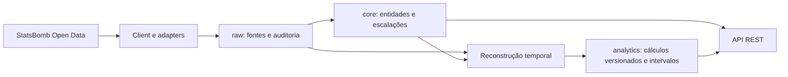

# Arquitetura do sistema

Monólito modular com FastAPI, SQLAlchemy e PostgreSQL. O fluxo atual é:

## Camadas e armazenamento

- `integrations`: HTTP, retries, validação e adaptação do contrato StatsBomb.
- `ingestion`: comandos explícitos, persistência, relógio/participação e validações.
- `modules`: endpoints e schemas de resposta.
- `infrastructure`: configurações, engine e convenções do banco.
- `raw`: `ingestion_runs`, `provider_payloads`, `ingestion_errors`.
- `core`: `competitions`, `seasons`, `teams`, `matches`, `players`,
  `match_lineups`, `external_id_mappings`.
- `analytics`: `participation_calculations`, `player_match_participation`,
  `player_participation_intervals`.

A reconstrução temporal permanece em `ingestion` nesta primeira implementação;
a separação em um motor analítico mais amplo será avaliada com as próximas métricas.
O schema analytics existe e contém resultados; ainda não há módulo genérico de
analytics, métricas ofensivas/defensivas ou agregações por temporada.

## Integridade e rastreabilidade

UUIDs internos independem dos fornecedores. O mapeamento diferencia competição,
temporada, equipe, partida e jogador. A temporada externa usa competição:temporada.
Payloads originais são preservados separadamente dos dados normalizados.

FKs compostas vinculam cálculo e escalação à mesma partida. Artefatos analíticos
novos são confirmados juntos, associados à fórmula e aos hashes das fontes.
O lock CORE_INGESTION_LOCK_ID serializa os escritores atuais. Ausência não vira zero.

SQLAlchemy é usado com SQL explícito; Base.metadata ainda não tem modelos ORM.
Autogenerate é bloqueado até que o metadata esteja completo. Migrações manuais
são verificadas no CI em PostgreSQL isolado com upgrade, downgrade e reaplicação.

Timestamps de auditoria são timezone-aware, tratados em UTC. O relógio da partida
é uma duração relativa, não um timestamp UTC. kickoff_at permanece ausente até
tratarmos explicitamente o fuso da fonte.

## API e limites

A API lê entidades/cálculos do banco. A rota providers é uma prévia que consulta
a fonte externa. Falhas SQLAlchemy recebem 503; indisponibilidade do fornecedor
na prévia recebe 502. Não há frontend, operação em produção, agendamento nem
reconciliação automática de execuções interrompidas.

O recorte temporal foi validado na final de 2022. Escalações, eventos de entrada/
saída e limites da fórmula estão descritos em
[participação temporal](../analytics/elapsed-on-field.md) e no
[pipeline](../ingestion/participation.md).

Referências: https://fastapi.tiangolo.com/deployment/docker/ e
https://alembic.sqlalchemy.org/en/latest/tutorial.html
